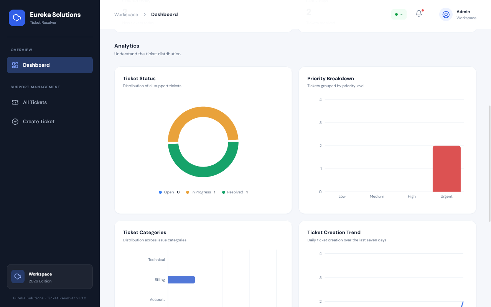
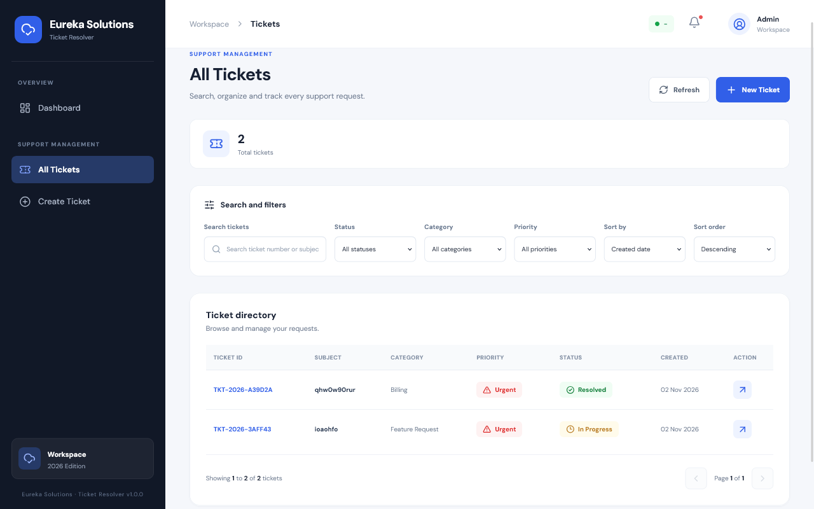
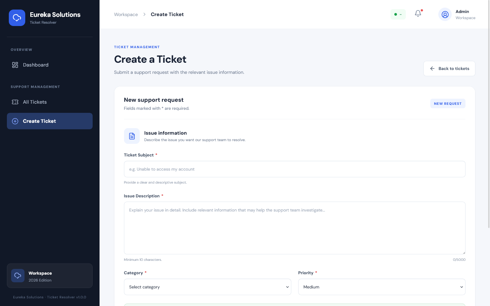
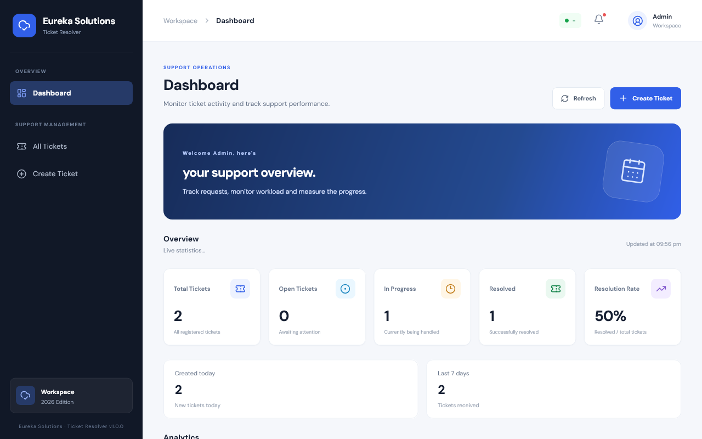

Eureka Solutions . Ticker Resolver

Objective
Build a basic support-ticket system with ticket creation, status updates, and a summary dashboard.
Requirements
 Each ticket should have a subject, description, category, priority, status, and creation date.
 Allow users to create and view tickets.
 Allow ticket status to be updated to Open, In Progress, or Resolved.
 Provide filters by status, category, and priority.
 Display the total number of tickets and counts by status on a dashboard.
 Keep a history of status changes with the previous status, new status, and timestamp.
Frontend
 Create a ticket submission form, ticket list, ticket details view, and dashboard.
 Use clear labels for ticket status and priority.
 Show loading, empty, success, and error states.
 Refresh the ticket information and dashboard after an update.
Backend
 Create API endpoints to create, list, retrieve, and update tickets.
 Store tickets and status history in a database.
 Validate required fields and allowed status/priority values.
 Calculate dashboard counts from stored data.
 Handle invalid ticket IDs and server errors appropriately.

Setup 
Run these commands from the project root:
npm install
cd backend
npm install
cp .env.example .env
cd ../frontend
npm install
cp .env.example .env
cd ..

Start MongoDB
docker compose up -d mongodb
docker compose ps

cd backend
npm run db:seed
npm run dev
The API runs at http://localhost:5000.

Start the frontend (another terminal)
cd frontend
npm run dev
curl http://localhost:5000/api/health

API endpoints
http://localhost:5000/api

GET	/health	
POST	/tickets	Create a ticket
GET	/tickets	List tickets
GET	/tickets/:id	
PATCH	/tickets/:id/status	
GET	/tickets/:id/history	
POST	/tickets/:id/comments	
GET	/tickets/:id/comments	
GET	/dashboard/summary	

Create a ticket
POST /tickets

Example JSON body:
{
  "subject": "Unable to log in",
  "description": "I cannot access my account even though my login details are correct.",
  "category": "Account",
  "priority": "High"
}

GET /tickets

Example JSON body:
{
  "status": "In Progress",
  "changedBy": "Support Agent"
}

GET /tickets/:id/history

POST /tickets/:id/comments

Example JSON body:
{
  "authorName": "Support Agent",
  "message": "We are checking the reported problem."
}

Ticket number	Subject	  Category	Priority	Current status
TKT-2026-A10001	Unable to log in to my account	Account	High	Open

  

  

  

  

